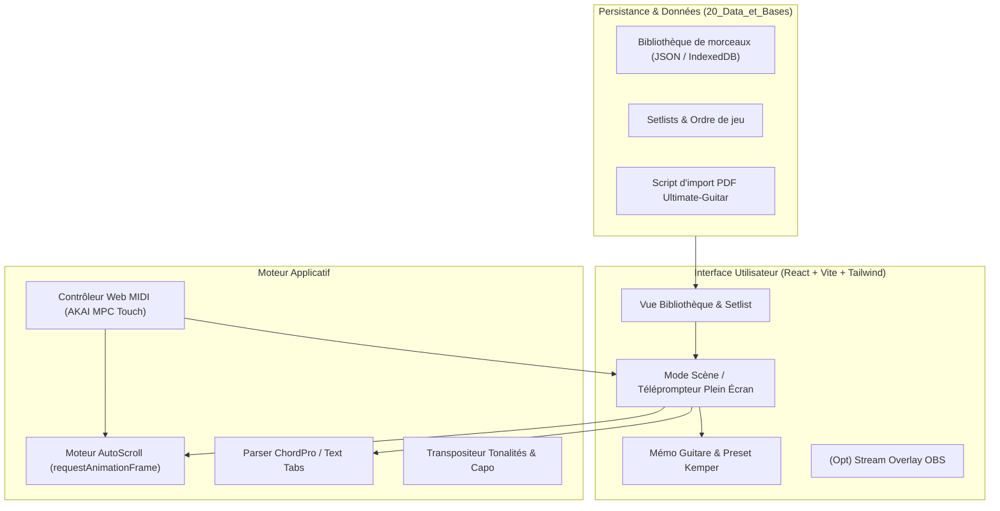

# Architecture Système & Design — Your Reign Is Over (design.md)

## 1. High-Level Architecture (Application Web Locale)



---

## 2. Architecture d'Exécution & Cognitive (SKILL.state & Triade)

### 1. Protocole SKILL.state (Exécution Procédurale Scalable)
- **Schéma d'État Canonique ($\Sigma$)** :
  ```json
  {
    "active_setlist_id": null,
    "current_song_id": null,
    "scroll_status": "paused",
    "scroll_speed_pps": 35,
    "active_instrument": null,
    "kemper_preset": null,
    "capo_fret": 0,
    "midi_connected": false
  }
  ```
- **Opérateur de Fusion Déterministe ($\oplus$)** : Mise à jour sans effet de bord, sémantique de suppression par clé `null`.
- **Raisonnement Éphémère ($R_t$)** : Détruit après application des transitions d'état.

---

## 3. Spécifications Ergonomiques & UI du Mode Scène
1. **Zéro Distraction** :
   - Fond sombre ultra-profond (`#0b0f19` ou noir pur `#000000`) pour minimiser la fatigue oculaire et maximiser la lisibilité sous les projecteurs de stream.
   - Textes de paroles en blanc cassé / haute lisibilité (`#f1f5f9`), accords en couleur vive distincte (or / ambre `#f59e0b` ou turquoise cyan `#06b6d4`).
2. **Affichage des Accords** :
   - Au-dessus des syllabes correspondantes, police à chasse fixe (monospace moderne style JetBrains Mono ou Roboto Mono).
3. **Barre de Contrôle Discrète** :
   - Vitesse de défilement (pixels/seconde ou slider tempo).
   - Boutons Play/Pause, Recommencer, Morceau précédent, Morceau suivant.
   - Indicateur visuel d'instrument préconisé (ex: badge "Duesenberg Paloma - Capo 2 - Kemper Crunch 4").
   - Masquage automatique des contrôles après 3 secondes d'inactivité de la souris pendant le défilement.
